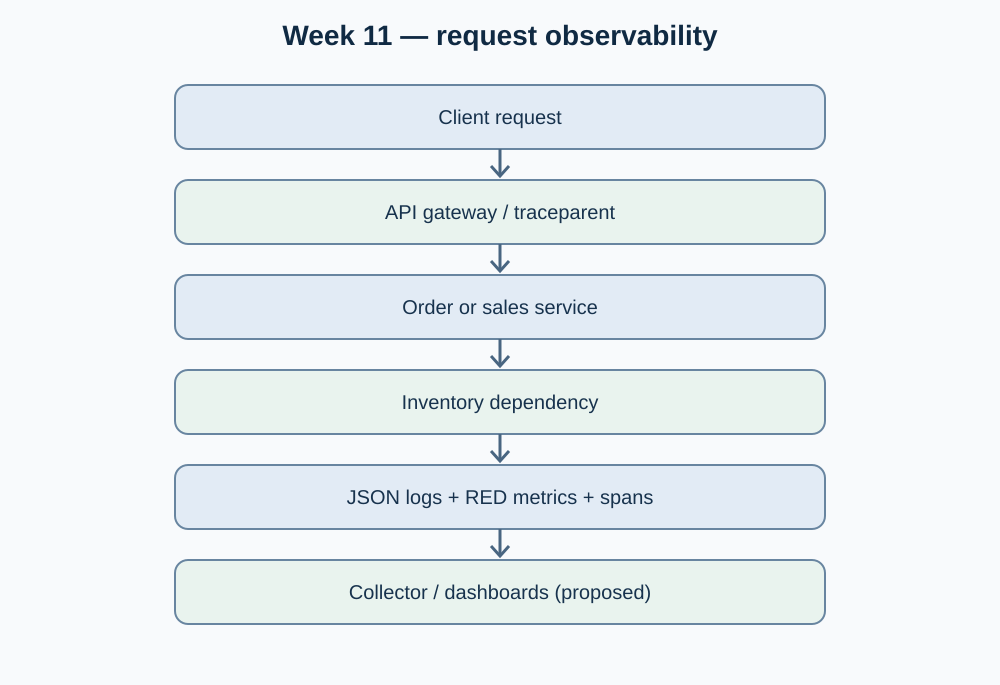

# Week 11 — Session 01

## Observability: structured logs, metrics and distributed tracing — OptiView

**Moodle objective:** Instrument services with structured logs, a propagated trace/correlation identifier, basic request-rate/error/latency metrics and end-to-end traces for multi-service requests.

**Scope of this contribution:** Technical design and gap assessment based on the OptiView documentation. No individual instrumentation commit, running collector or trace screenshot has been verified for Week 11. The items below are a reproducible **implementation proposal**, not evidence of a deployed stack.

## 1. Current project baseline

OptiView already documents the three observability pillars under [`13-operations/observability.md`](https://github.com/code-corhuila/opti-docs/blob/main/13-operations/observability.md): structured JSON logs, RED metrics and distributed traces. The operations section also documents incident handling. This is a **team documentation baseline**, not proof that every service emits and exports these signals in a running environment.

## 2. Proposed cross-service instrumentation

1. **Logs:** each service should emit structured JSON with `timestamp`, `level`, `service`, `environment`, `trace_id` or mapped `correlationId`, `message`, HTTP operation, status and duration. Do not log credentials, tokens or patient data. Agree on a canonical identifier and naming policy before implementation.
2. **Metrics:** expose an internal-only `/metrics` endpoint or an equivalent exporter. Minimum measurements: request total by service/route/status, request duration histogram and in-flight request count. Dashboard symptoms: request rate, 5xx percentage, p95/p99 latency and saturation indicators.
3. **Traces:** use W3C `traceparent` propagation through the gateway and downstream HTTP calls. Instrument child spans across the sales/order and inventory path and relevant database operations. Preserve the same `trace_id` for the entire request; generate distinct `span_id` values per operation.
4. **Correlation:** return a correlation identifier in responses where appropriate and include it in logs. Do not confuse a custom correlation header with the full OpenTelemetry trace context.

## 3. OptiView scenario and acceptance checks

**Example:** An administrator or sales user submits an order. Trace `gateway → order/sales service → inventory dependency → persistence` and locate the span contributing most to latency or errors. The exact runtime services and routes must be checked against current deployed contracts before a test is executed.

| Acceptance criterion | Evidence to capture | Current outcome |
|---|---|---|
| All touched services generate parsable JSON log records | Redacted sample logs from two services with identical `trace_id` | Pending |
| Request counters and latency histogram are scrapeable | Internal `/metrics` output and dashboard screenshot | Pending |
| A trace shows parent-child spans across at least two services | Trace screenshot/URL and timestamps | Pending |
| An injected failure is visible in logs, metrics and the same trace | Test case, expected/actual outcome and CI execution | Pending |
| Sensitive values are absent from logged fields | Log review and secret/PII scan | Pending |

## 4. Observability flow diagram

The diagram is **proposed instrumentation**. It does not assert that collectors, Prometheus, Grafana or Jaeger have been installed.

## 5. Traceability and remaining work

- Existing team operations documentation: [`13-operations/observability.md`](https://github.com/code-corhuila/opti-docs/blob/main/13-operations/observability.md).
- Architecture context: [`05-architecture/deployment.md`](https://github.com/code-corhuila/opti-docs/blob/main/05-architecture/deployment.md).
- Moodle source: Week 11, Session 01, "Logs, metrics, traces", "Correlation ID", "Golden signals" and "This week".
- To close the task: confirm service ownership, implement exporters/instrumentation, run a cross-service request and attach links to code, CI and the trace evidence.
