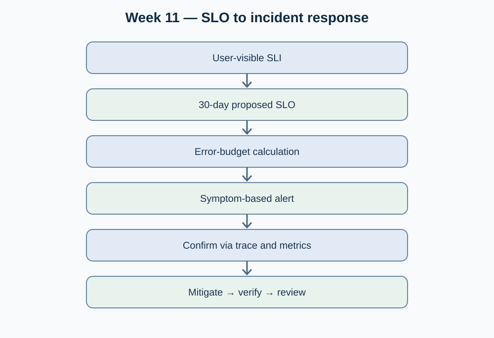

# Week 11 — Session 02

## Planning: SLI, SLO, error budgets, symptom-based alerts and runbooks

**Moodle objective:** Define 2–3 user-visible SLOs with measurement windows, calculate error budgets, define actionable alerts and provide an incident response runbook.

**Status:** Draft reliability plan for OptiView. The thresholds below are **proposed targets requiring team approval**, not measured production performance.

## 1. Candidate SLI / SLO definitions

| User-facing service behavior | SLI definition | Proposed SLO | Window |
|---|---|---|---|
| Successful order creation | `valid order requests returning expected success / total eligible order requests` | >= 99.5% | Rolling 30 days |
| Order lookup latency | `eligible GET order requests completed < 500 ms / total eligible GET order requests` | >= 95% | Rolling 30 days |
| Reporting freshness (if asynchronous projection is implemented) | `report observations refreshed within 5 minutes / eligible observations` | >= 99% | Rolling 30 days |

Define exclusions explicitly (for example, malformed requests and deliberate user cancellations) and identify the exact HTTP routes and telemetry labels with the implementation team. The reporting-freshness objective is conditional: the earlier HU-24 implementation evidence does **not** prove an asynchronous read projection exists.

## 2. Error budget and release policy

For a proposed 99.5% order-success SLO, the allowed failure fraction is `100% - 99.5% = 0.5%` in the 30-day window. For an example of **10,000 eligible orders**, that permits **50 unsuccessful requests**. This example is arithmetic, not an observed OptiView volume.

- At normal burn rate: continue releases with standard QA and rollback readiness.
- When the projected budget consumption rises abnormally: stop nonessential releases, investigate failures and prioritize stability.
- When the budget is exhausted: pause risky changes until recovery is verified and the team explicitly authorizes a release.

## 3. Proposed alert policy

| Symptom | Trigger proposal | Severity | Responsible role | Runbook |
|---|---|---|---|---|
| Order creation errors | 5xx or failed eligible orders > 2% during 10 minutes with sufficient request volume | P1 | Backend on-call / technical lead (to assign) | Section 4 |
| Order lookup latency | p99 > 1 s over 15 minutes with meaningful traffic | P2 | Backend on-call (to assign) | Section 4 |
| Severe error-budget burn | Sustained fast burn that threatens the SLO budget | P0/P1 after impact review | Incident commander (to assign) | Section 4 |

Avoid pages for isolated CPU spikes; correlate signals with end-user impact. Thresholds and contacts must be validated with actual baseline traffic and the team's incident policy.

## 4. Runbook — order creation failures

1. **Detect and classify:** acknowledge the symptom alert; measure error ratio and impacted endpoints; classify severity using OptiView incident policy.
2. **Confirm:** inspect dashboard time window; select affected `trace_id` values; correlate gateway, order and inventory logs; check dependency health and recent deployments.
3. **Mitigate:** if correlated with a recent rollout, execute the approved rollback; otherwise isolate the failing dependency or disable the affected operation only if approved and safe for data consistency.
4. **Escalate:** notify the assigned service owner and incident commander for P0/P1; record incident timeline, impact and mitigation decisions.
5. **Verify:** repeat smoke tests; confirm falling error rates, restored latency and correct order/inventory consistency; retain trace, dashboard and deployment identifiers.
6. **Follow up:** produce a blameless review, assign corrective actions and adjust alerts based on observed signal quality.

## 5. Proposed implementation stories and acceptance criteria

| Working item (not registered backlog ID) | Acceptance evidence | Status |
|---|---|---|
| OBS-11-A: instrument request logs, metrics and trace propagation | Same trace across >=2 services, dashboard and tests | todo |
| OBS-11-B: adopt measurable SLOs and alert rules | Reviewed SLO definitions, query and reproducible alert test | todo |
| OBS-11-C: rehearse an order failure runbook | Timed test record, responder and recovery verification | todo |

## 6. Planning diagram and references

- Team baseline: [`13-operations/incident-management.md`](https://github.com/code-corhuila/opti-docs/blob/main/13-operations/incident-management.md), [`13-operations/observability.md`](https://github.com/code-corhuila/opti-docs/blob/main/13-operations/observability.md).
- Moodle source: Week 11, Session 02, "SLI/SLO/error budget", "Alerts", "Runbooks" and "This week".
- **Not verified:** approved numeric targets, deployed alert definitions, named on-call owner and rehearsal evidence.
