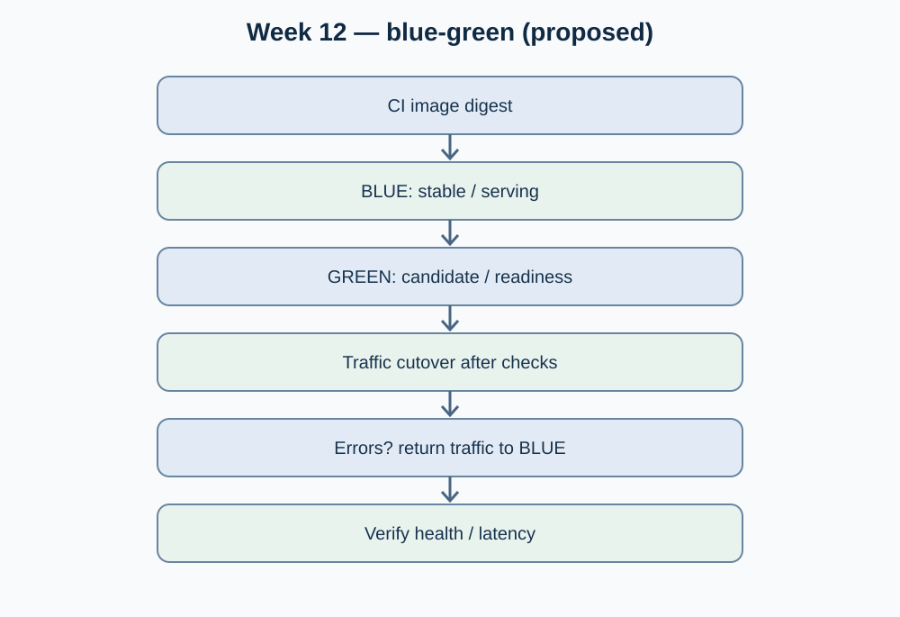

# Week 12 — Session 01

## Cloud deployment models and zero-downtime strategies — OptiView

**Moodle objective:** Deploy a tagged image to a cloud or production-like host; use health checks and a rolling or blue-green release strategy, while accounting for horizontal scaling and failures.

**Scope:** Design review and test checklist. A successful cloud deployment, production-like host demonstration and zero-downtime switchover are **not verified** by the available Week 12 evidence.

## 1. Deployment model assessment

Moodle compares VM/IaaS, managed containers, PaaS and serverless. The OptiView deployment document describes Docker Compose on one host per environment as its current documented direction, with managed orchestration presented as a potential future option, not an approved current implementation: [`05-architecture/deployment.md`](https://github.com/code-corhuila/opti-docs/blob/main/05-architecture/deployment.md).

For a course MVP, a production-like Docker host can meet the lesson's requirement *if* real container execution, health checks, switching and rollback are demonstrated. Do not claim native Kubernetes or production cloud availability without deployment URLs and execution evidence.

## 2. Immutable artifact and promotion flow

1. Build a version-tagged image once in CI and publish its digest to a registry.
2. Deploy that **same digest** to `develop`, then `qa`, then `main`/production-equivalent, with separate environment configuration.
3. Before routing users, verify readiness and a functional smoke-test endpoint.
4. Record the image digest, approvals, environment, timestamps and result. Rebuilding a different image for production breaks artifact traceability.

Team context: [Sales API GHCR publication workflow commit](https://github.com/code-corhuila/opti-sales-api/commit/55719ef0a20cbce2f3373cb14de5a11d46be6836). This is a team CI code change from October 6, **not proof of an individual Week 12 deployment or green workflow run**.

## 3. Zero-downtime deployment proposal

**Preferred experiment: blue-green** for an HTTP-facing, stateless service with sufficient capacity to run both variants.

- Blue serves existing traffic while green is started with the candidate image.
- Verify health/readiness, dependencies, authentication and a representative order/report operation on green.
- Switch proxy or load-balancer routing to green; retain blue while post-switch metrics are evaluated.
- If symptoms exceed the guardrail, route traffic back to blue and confirm recovery.

**Important limitation:** a single Docker Compose host does not automatically supply a load balancer or zero-downtime traffic switching. Both variants, routing changes and graceful connection handling need explicit configuration and a real test. Database schema compatibility must also be checked before rollback.

## 4. Acceptance and failure-injection checklist

| Check | Required evidence | Outcome |
|---|---|---|
| Versioned container image from CI | Image reference + digest + successful CI job | Pending |
| Production-like host deployment | Host/environment record, container status and smoke test | Pending |
| Readiness checks before cutover | `/health` or equivalent test, captured status | Pending |
| Blue-green switch without user-visible interruption | Traffic test during promotion and error/latency graph | Pending |
| Simulated unhealthy green and rollback | Timestamped execution, previous digest restored, health recovered | Pending |
| Data compatibility on rollback | Migration review and consistency smoke tests | Pending |

## 5. Diagram and references

- Team context: [`05-architecture/deployment.md`](https://github.com/code-corhuila/opti-docs/blob/main/05-architecture/deployment.md).
- Moodle source: Week 12, Session 01, deployment models, immutable builds, rolling/blue-green/canary and "This week".
- No deployment URL, measured downtime or execution record is asserted in this analysis.
