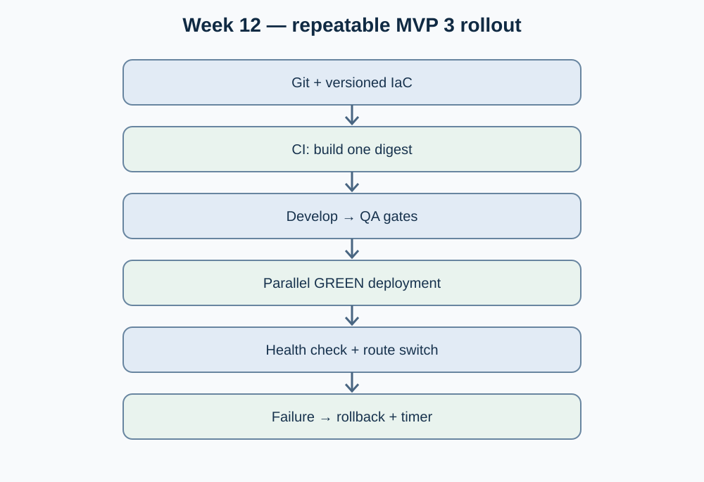

# Week 12 — Session 02

## MVP 3 release planning: artifact promotion, IaC and rehearsed rollback

**Moodle objective:** Produce a repeatable deployment plan with immutable artifact promotion, version-controlled infrastructure as code, zero-downtime strategy and a documented, timed rollback.

**Status:** Implementation plan and candidate acceptance criteria. This document is not evidence of an executed MVP 3 release or rehearsal.

## 1. Promotion and approvals

| Gate | Input | Validation | Output |
|---|---|---|---|
| CI build | Reviewed code and tests | Build, tests, basic security checks | Single image digest in registry |
| Development | Exact built digest | Startup health and service smoke test | Dev deployment record |
| QA | Same digest with QA configuration | Contract/integration tests, fault scenario, approval | QA approval record |
| Production-like | Same digest with production-equivalent configuration | Preflight, readiness, traffic switchover, post-deploy metrics | Release record with rollback reference |

The environment branch mapping and approval requirements must match the professor's repository instructions and actual team pipeline; none are inferred to be operational from this table.

## 2. Infrastructure as code

Keep the environment definition in Git (Compose files and associated reviewed configuration for the selected host). Parameterize ports, image digests, service URLs, resource constraints and health checks. Store secrets outside Git using protected environment variables or the approved secret manager. Validate configurations and compare dev/QA/production-like topology to reduce drift.

**Reproducibility check:** recreate a clean QA host from version-controlled definitions, start the exact image digest and capture health results. Until executed, this is an acceptance test, not a completed outcome.

## 3. Rollback procedure and rehearsal

1. Record active and candidate image digests and database compatibility assumptions before deployment.
2. Keep the previously healthy blue deployment available during the green release.
3. Deploy green without switching public traffic; evaluate readiness, representative routes and service dependencies.
4. Switch traffic only after checks pass. Observe errors and p95/p99 latency.
5. **Failure drill:** inject an unhealthy green instance or a safe, controlled request failure in a non-production environment.
6. Switch traffic back to blue; verify successful requests and recover expected traffic distribution.
7. Write down start/end timestamps, observed impact, owner, commands specific to the tested platform and artifacts.

A target rollback time (for example, under five minutes) is a **proposed acceptance criterion**, not a measured outcome. Never promise automatic rollback without a verified routing mechanism and pipeline.

## 4. MVP 3 implementation stories (proposed)

| Working item (not approved HU) | Testable acceptance criterion | Status |
|---|---|---|
| DEP-12-A: immutable CI artifact | One digest used in development, QA and production-like environments | todo |
| DEP-12-B: reproducible environment | Host recreated from versioned IaC and healthy containers reported | todo |
| DEP-12-C: blue-green promotion | Readiness gate + uninterrupted representative traffic test | todo |
| DEP-12-D: timed rollback rehearsal | Restores previous healthy version; measured duration and post-checks documented | todo |

## 5. Deployment diagram and risks

- **Risks:** unavailable second deployment slot, incomplete health checks, schema incompatibility, environment drift, missing approvals and no incident monitoring.
- **Mitigation:** require a QA rehearsal, immutable digests, reversible routing, compatible schema changes and test evidence before release approval.

## 6. References and evidence status

- Team architecture: [`05-architecture/deployment.md`](https://github.com/code-corhuila/opti-docs/blob/main/05-architecture/deployment.md).
- Team DevOps guidance: [`10-devops/README.md`](https://github.com/code-corhuila/opti-docs/blob/main/10-devops/README.md).
- Existing CI code example (other team contribution): [Sales API image publishing workflow](https://github.com/code-corhuila/opti-sales-api/commit/55719ef0a20cbce2f3373cb14de5a11d46be6836).
- Moodle source: Week 12, Session 02, artifact promotion, IaC, rollback and "This week".
- **Not verified:** actual IaC recreation, promotions, deployment, rollback measurement, approvals and runtime tests.
