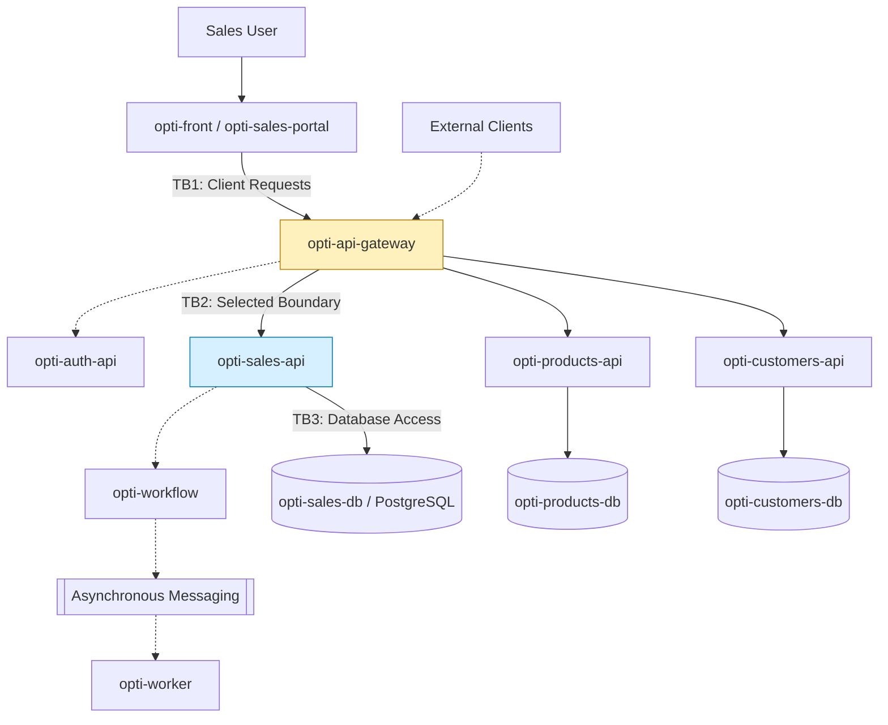

# Week 13 - OptiView Attack Surface Map

## 1. Objective

Identify the attack surface of OptiView and document the trust boundaries affecting the sales reporting workflow described in HU-24.

My assigned boundary is TB2: opti-api-gateway to opti-sales-api, claimed in issue #37.

## 2. Architecture and Data Flow

The diagram represents the documented OptiView service architecture. Some integrations and security controls require implementation verification.

Solid links represent principal documented flows. Dashed links indicate conceptual dependencies requiring verification of their exact direction or implementation.

## 3. Trust Boundary Inventory

| ID | Boundary | Security Concern |
|---|---|---|
| TB1 | Browser to opti-api-gateway | Untrusted client requests |
| TB2 | opti-api-gateway to opti-sales-api | Identity, roles and report authorization |
| TB3 | opti-sales-api to opti-sales-db | Database privileges and data integrity |
| TB4 | Sales workflow to asynchronous messaging | Event authenticity and duplication |
| TB5 | Gateway to other domain APIs | Cross-service access restrictions |

TB2 is the selected boundary for my individual STRIDE assessment.

## 4. Asset Inventory

| Asset | Location | Classification |
|---|---|---|
| Public product descriptions | opti-products-api | Public |
| Sales totals and report summaries | opti-sales-api | Confidential |
| Work order statuses | opti-sales-api / opti-sales-db | Internal |
| Customer and patient records | opti-customers-api / database | Restricted |
| Authentication tokens | Client / gateway boundary | Restricted |
| Sales database credentials | Service runtime configuration | Restricted |
| Operational event metadata | opti-workflow / opti-worker | Internal |

These classifications are proposed for threat modeling and must be validated against the team data governance rules.

## 5. Entry Points of TB2

| Entry Point | Origin | Data | Security Verification |
|---|---|---|---|
| Sales reporting request | opti-front through gateway | Sales reporting filters | Verify token and permissions |
| Timeseries report | Gateway to opti-sales-api | Sales totals by period | Verify access control |
| Orders-by-status report | Gateway to opti-sales-api | Order status counts | Verify role authorization |
| Sales API internal connection | opti-api-gateway | Forwarded identity and request metadata | Verify gateway bypass protection |

Exact HTTP paths, ports and current middleware behavior must be confirmed from the API contracts and implementation before CP2.

## 6. Security Observations

- Browser requests must not be trusted solely because they pass through the frontend.
- The sales API should enforce authorization even if the gateway authenticates users.
- Report parameters must be validated server-side.
- Database credentials must never be exposed to frontend applications.
- Sensitive report data should not appear in publicly accessible logs.

## 7. Next Checkpoint

CP2 will assess the six STRIDE categories on TB2:

- S: Spoofing
- T: Tampering
- R: Repudiation
- I: Information Disclosure
- D: Denial of Service
- E: Elevation of Privilege

Each threat will include likelihood, impact, risk score, existing controls and proposed mitigations.

## References

- https://github.com/code-corhuila/opti-docs/blob/main/05-architecture/overview.md
- https://github.com/code-corhuila/opti-docs/blob/main/04-requirements/user-stories.md
- https://github.com/code-corhuila/opti-docs/issues/37
