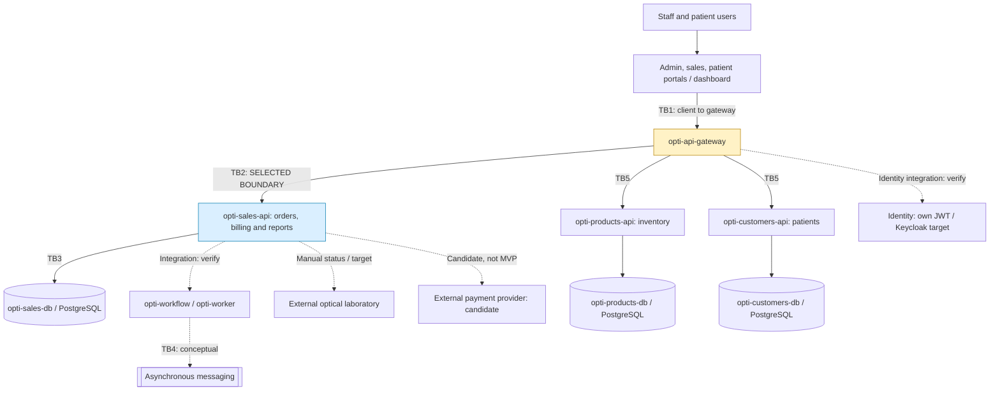

# Week 13 — OptiView Attack Surface Analysis

## 1. Objective and Scope

This document identifies OptiView's attack surface, assets, entry points,
data flows, and trust boundaries.

My assigned boundary is TB2: `opti-api-gateway` to `opti-sales-api`.

Boundary claim:
https://github.com/code-corhuila/opti-docs/issues/37

The assessment focuses on HU-24 sales reporting, authorization,
confidential business data, and service-to-service communication.

The diagram distinguishes the target microservice architecture from
the components and interactions that require deployment verification.

## 2. Architecture and Data Flow

The team architecture describes target microservices and a previous
Cut 1 modular monolith. These are not the same deployment.

Repository mappings:
- Patient domain: `opti-customers-api` / `opti-customers-db`.
- Inventory domain: `opti-products-api` / `opti-products-db`.
- Orders and billing domains: `opti-sales-api` / `opti-sales-db`.
- API gateway: `opti-api-gateway`.

Solid links represent principal target-architecture relationships.
Dashed links represent candidate, conceptual, manual, or unverified flows.

The diagram is a threat-modeling view, not proof that every component
is deployed or that each proposed connection is implemented.

## 3. Trust Boundary Inventory

| ID | Boundary | Security concern |
|---|---|---|
| TB1 | Client applications to gateway | Untrusted input, identity and tokens |
| TB2 | Gateway to sales API | Authentication context, roles and report access |
| TB3 | Sales API to sales database | Credentials, data integrity and least privilege |
| TB4 | Workflow to messaging | Event authenticity, replay and duplication |
| TB5 | Gateway to customer/product APIs | Domain authorization and isolation |

**TB2 is my assigned boundary for the STRIDE analysis.**

## 4. Asset Inventory

| Asset | Location | Classification |
|---|---|---|
| Public product descriptions | Products API | Public |
| Sales totals and report summaries | Sales API | Confidential |
| Order-status information | Sales API / Sales DB | Internal |
| Patient and customer records | Customers API / database | Restricted |
| Authentication tokens | Client / identity boundary | Restricted |
| Database credentials | Service runtime | Restricted |
| Operational event metadata | Workflow / worker | Internal |

These classifications are proposed for security analysis and must
be checked against the team's data-governance policies.

## 5. TB2 Entry Points

| Entry point | Caller | Data exchanged | Security check |
|---|---|---|---|
| `GET /api/v1/reports/seller-sales` | Gateway / authorized service | Seller-sales report | SERVICE authorization |
| Timeseries sales reporting | Gateway / client workflow | Aggregated sales by period | Verify route, identity and filters |
| Orders-by-status reporting | Gateway / client workflow | Order-status counts | Verify route and permissions |
| Sales API boundary | Gateway or internal caller | Identity, roles and parameters | Prevent unauthorized access and gateway bypass |

The seller-sales endpoint and SERVICE requirement were verified
against the Sales API source code.

Other reporting paths, deployed routing rules, and service-level
authentication behavior require separate verification.

## 6. TB2 Security Observations

- Frontend restrictions cannot replace server-side authorization.
- The Sales API must validate roles before executing reporting logic.
- Report filters must be validated before querying business data.
- Unauthorized responses must not expose confidential sales reports.
- Sensitive credentials must not appear in responses or logs.
- Request tracing and audit records should support investigations.
- Resource limits should protect reporting from excessive requests.

## 7. Related Security Work

The six STRIDE categories are evaluated in Pull Request #44:

https://github.com/code-corhuila/opti-docs/pull/44

The highest-priority security stories are:

- Issue #45: SERVICE-role authorization.
- Issue #46: Reporting filter validation.
- Issue #47: Confidential information disclosure.

## 8. References

- https://github.com/code-corhuila/opti-docs/blob/main/05-architecture/overview.md
- https://github.com/code-corhuila/opti-docs/issues/37
- https://github.com/code-corhuila/opti-docs/pull/44
