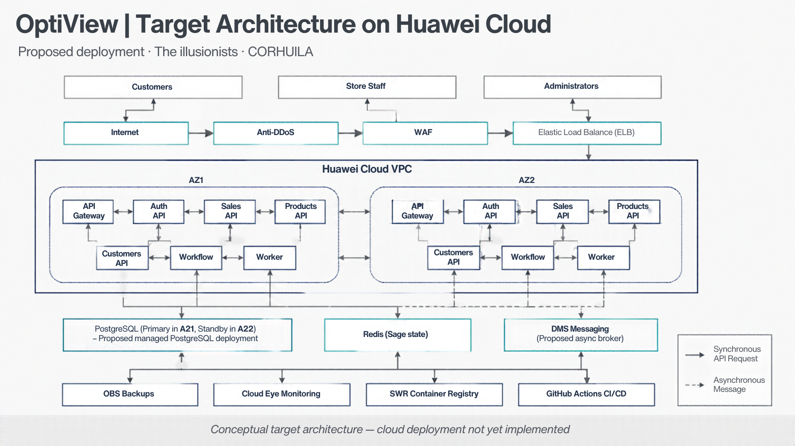

# Architecture design note — The illusionists / OptiView

## 1. Target architecture

OptiView supports the operational processes of an optical retail business through web interfaces and services for authentication, customers, products, and sales. Its distributed architecture also includes an API Gateway, persistence components, workflow coordination, and background processing. This design note proposes a possible evolution toward Huawei Cloud; it does **not** claim that the team has deployed this infrastructure in Huawei Cloud. The baseline is the division of responsibilities documented in the team's repositories and the actual service composition described in `code-corhuila/opti-infra/compose.yml`.

Public requests would enter through Elastic Load Balance (ELB), protected by Web Application Firewall (WAF) and HTTPS. Behind the load balancer, Cloud Container Engine (CCE) would distribute application replicas across **two availability zones (AZs)** within one Huawei Cloud region. A Virtual Private Cloud (VPC) would separate application and data subnets. Restrictive security groups would prevent direct public access to PostgreSQL, Redis, and internal event transport. Client interfaces would communicate through the gateway, while individual domain services would enforce resource-level authorization rather than relying exclusively on token validation at the edge.

The proposed design retains domain boundaries for `opti-auth-api`, `opti-customers-api`, `opti-products-api`, and `opti-sales-api`. RDS for PostgreSQL with Multi-AZ high availability is a candidate for critical persistence, with logical isolation appropriate to each service; the final choice must consider compatibility, existing schemas, and operating costs. `opti-workflow` would coordinate distributed business operations, and `opti-worker` would execute decoupled tasks. Redis would maintain Saga coordination state, whereas a compatible managed messaging service would transport asynchronous events. These responsibilities should not be confused: storing workflow state is different from operating an event broker.

| Component in the diagram | Defined in (file of your team's -docs) |
|---|---|
| Web portals and `opti-front` | `09-microservices/service-catalog.md`; `05-architecture/overview.md` |
| `opti-api-gateway` | `09-microservices/services/01-api-gateway/README.md`; `05-architecture/overview.md` |
| `opti-auth-api` | `09-microservices/services/02-auth-service/README.md`; `06-data/models.md` |
| Customer, product, and sales domains | `09-microservices/service-catalog.md`; `06-data/models.md` |
| PostgreSQL domain persistence | `06-data/models.md`; `05-architecture/overview.md` |
| Coordination, events, and Redis | `05-architecture/pattern-guide.md`; `05-architecture/overview.md` |
| Observability and delivery | `13-operations/observability.md`; `10-devops/environments.md` |

Some team documents still contain generic template sections. Accordingly, these references establish the design context, while concrete repository and container names are checked against `code-corhuila/opti-infra/compose.yml`. ELB, CCE, WAF, RDS, managed messaging, Application Operations Management (AOM), Log Tank Service (LTS), and Cloud Eye are **proposed mappings**, not verified existing resources. Huawei course chapters on availability, networking, data, security, and containers inform these choices.

## 2. Five principles

The five principles translate identified weaknesses and operational risks into architectural decisions. Cloud adoption should improve resilience and control without introducing unnecessary complexity for a relatively small application.

| Principle | Current weakness | Evidence in -docs | Design decision | Huawei Cloud service |
|---|---|---|---|---|
| Reliability | Single-host deployment creates a potential infrastructure single point of failure; Multi-AZ redundancy is not demonstrated. | `05-architecture/overview.md` | Run at least two replicas of critical APIs and the gateway across two AZs, with database failover. | CCE, ELB, RDS for PostgreSQL |
| Security | Gateway JWT validation does not replace per-resource authorization; manipulated identifiers may expose another user's records. | `09-microservices/services/01-api-gateway/README.md` | Enforce ownership and role checks in every API; use TLS, private subnets, and managed secrets. | WAF, VPC, IAM, DEW |
| Performance efficiency | Interactions among sales, products, and workflow can increase latency and waiting time under load. | `05-architecture/pattern-guide.md` | Decouple suitable operations through messaging and scale APIs against measured p95 latency. | CCE, AOM, DMS |
| Cost | Fixed resource allocations may waste capacity during periods of low demand. | `10-devops/environments.md` | Set conservative replica floors and ceilings, and review resource usage before increasing capacity. | CCE, Cloud Eye, Cost Center |
| Operations | Fragmented logs make it difficult to trace one transaction through gateway, sales, products, and workflow. | `13-operations/observability.md` | Centralize structured logs, correlation IDs, RED metrics, traces, and actionable alarms. | LTS, AOM, Cloud Eye, SMN |

These principles complement, rather than replace, business safeguards. A restarted service or repeated event must not cause a second inventory deduction. Similarly, token authenticity does not establish permission to read an arbitrary record. Identity spoofing, identifier tampering, and information disclosure must be addressed at service trust boundaries, not only through perimeter controls. The course's security and operations topics support this layered approach.

## 3. Scalability

The recommended strategy is **selective horizontal scaling**. Adding replicas everywhere would increase cost without necessarily improving throughput. The following thresholds are **initial engineering targets**, to be calibrated using load tests and actual traffic; they are not measured production results.

| Service | Scaling metric | Threshold (number and unit) | Min instances | Max instances |
|---|---|---|---|---|
| `opti-sales-api` | Average CPU utilization and request p95 latency | CPU > 70% for 5 minutes **or** p95 > 800 ms for 5 minutes | 2 | 6 |
| `opti-products-api` | Average CPU utilization and query p95 latency | CPU > 65% for 5 minutes **or** p95 > 500 ms for 5 minutes | 2 | 5 |

The autoscaling policy would add capacity when the defined condition persists and remove capacity only after a stable cooldown interval, limiting rapid scale-in/scale-out oscillations. Application replicas must remain interchangeable and avoid indispensable local session state. ELB would route requests to healthy instances, and CCE readiness checks would exclude containers unable to serve traffic. A later policy for `opti-worker` should use queue depth and oldest-message age rather than HTTP latency, provided that those metrics become available.

Sales operations require special attention because scaling increases concurrent requests. Two simultaneous purchase requests must not decrement the same stock twice. Consequently, idempotency keys, transactional inventory checks, and concurrency controls must remain effective across replicas. Where a sale spans multiple services, Saga coordination and compensation must preserve consistency when a downstream operation fails. Horizontal scaling improves capacity; it does not, by itself, solve distributed consistency. Huawei's course discussions of messaging, elastic capacity, and container orchestration provide the conceptual basis for this proposal.

## 4. Disaster recovery

- **Critical data store:** The PostgreSQL sales data store, including transaction records and statuses, coordinated with product inventory persistence and Saga state.
- **RTO:** **30 minutes**, proposed maximum time to restore essential operations after an availability-zone incident.
- **RPO:** **5 minutes**, proposed maximum acceptable age of unrecovered data.
- **DR pattern (chapter 11):** **Active-standby across two AZs**, supported by continuous replication, supervised failover, regular backups, and point-in-time recovery.
- **Why the pattern meets those numbers:** A prepared standby, health monitoring, and controlled promotion can support a recovery design targeting 30 minutes, but detection, failover, and application reconnection must be tested. A five-minute RPO requires verified replication lag and recoverable transaction logs; daily backups alone cannot demonstrate this target.

The recovery procedure would identify the failed zone, isolate affected components, promote the standby database, redirect application connections, and verify sales and inventory integrity. Incomplete transactions and pending events would then be reconciled using the established Saga rules. Recovery exercises should record actual elapsed recovery time, the last successfully restored transaction, and any inconsistencies found. Tests should be repeated after meaningful changes to the database, network, or workflow configuration.

These values are **service objectives**, not achieved service levels. In particular, a Multi-AZ configuration is not a substitute for backup restoration tests or protection against logical corruption. Huawei chapter 11 distinguishes Recovery Time Objective (RTO), which measures service restoration time, from Recovery Point Objective (RPO), which expresses tolerable data loss. Both must be validated through documented drills before the team can claim compliance.

## 5. Automated deployment

The design builds on automation already visible in the repositories. In `code-corhuila/opti-sales-api`, `.github/workflows/ci.yml` runs `mvn -B verify` for pull requests, and `.github/workflows/publish.yml` builds and publishes a Docker image from `deploy/Dockerfile` to GitHub Container Registry (GHCR). The shared `code-corhuila/opti-infra/compose.yml` brings together domain services, Redis, and observability components. The Huawei Cloud delivery stages below **extend this baseline**; a working CCE production pipeline has not been verified.

| Stage | Trigger | Tool or service | File in your team's repositories |
|---|---|---|---|
| Build | Open or update a pull request targeting `develop`, `qa`, or `main` | GitHub Actions, Java 21, Maven | `code-corhuila/opti-sales-api/.github/workflows/ci.yml` |
| Test | Same pull request; fail the check if `mvn verify` fails | Maven test lifecycle | `code-corhuila/opti-sales-api/.github/workflows/ci.yml` |
| Image | Push to `develop` or manually dispatch the publishing workflow | Docker Buildx and GHCR; SWR is a proposed destination | `code-corhuila/opti-sales-api/.github/workflows/publish.yml`; `deploy/Dockerfile` |
| Deploy to qa | Approve an image promotion after successful checks | Proposed CCE/SWR deployment; existing Compose configuration as baseline | `code-corhuila/opti-infra/compose.yml`; `TheIllusionists/Opti-docs/10-devops/environments.md` |
| Deploy to production | Manual approval following QA and functional validation | Proposed CCE progressive rollout with monitored traffic | `TheIllusionists/Opti-docs/10-devops/environments.md`; `code-corhuila/opti-infra/compose.yml` |
| Rollback | Failed smoke tests or excessive p95 latency/error rate after release | Restore the preceding immutable image; proposed CCE rollback | `TheIllusionists/Opti-docs/10-devops/environments.md`; `code-corhuila/opti-sales-api/.github/workflows/publish.yml` |

Every release image should carry an immutable commit-SHA tag rather than relying exclusively on `latest`. QA gates should test API contracts, resource-level authorization, idempotency, and failure scenarios between sales and products. Production promotion should require explicit approval, a defined observation window, and measurable rollback criteria. Database migrations should be backward compatible: reverting a container image cannot automatically reverse a destructive schema change. Huawei's automation and container chapters inform the proposed progression from source validation to controlled production deployment.

## 6. Decisions

- [ADR-C3-01](ADR-C3-01.md): Adopt horizontal scaling for `opti-sales-api` and `opti-products-api` across two availability zones, with CPU/latency thresholds and preserved idempotency guarantees.
- [ADR-C3-02](ADR-C3-02.md): Adopt Multi-AZ active-standby recovery for critical sales data, with proposed **30-minute RTO** and **5-minute RPO**, validated through recovery drills.

Each ADR must independently describe the context, selected decision, at least two rejected alternatives with reasons, and both positive and negative consequences. ADR-C3-01 supports section 3, whereas ADR-C3-02 supports section 4. Neither decision should be represented as an already deployed Huawei Cloud implementation. Acceptance depends on feasibility testing, cost assessment, and the team's risk review.
